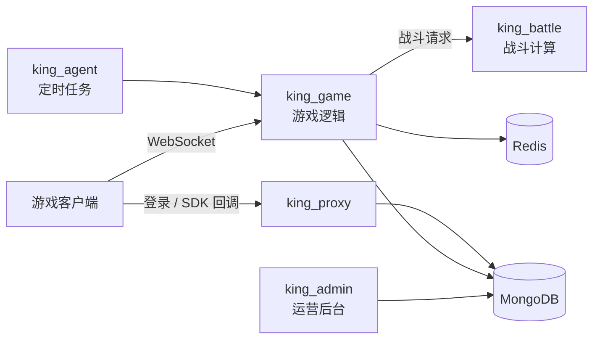

# SLG Game Server — 策略类手游服务端（工作项目存档）

> **版权声明**：本仓库为作者在原任职公司参与开发的策略类（SLG）手游服务端代码存档，初始代码由公司代码库导入，**著作权归原公司所有**。仓库仅作个人工作经历记录，不提供任何开源许可，请勿用于商业或二次分发。

## 项目概览

Node.js 多进程游戏服务端，按职责拆分为五个服务，MongoDB 持久化、Redis 做缓存与跨服务通信，PM2 统一编排。

| 服务 | 职责 | 主要依赖 |
| --- | --- | --- |
| `king_game` | 游戏逻辑核心：角色、地图事件、联盟、国王战与竞猜玩法、定时结算 | ws、mongoose、redis |
| `king_battle` | 战斗计算服务 | express |
| `king_proxy` | 登录与第三方 SDK 对接（账号、订单回调） | koa、ws、mongoose |
| `king_agent` | 定时任务 | — |
| `king_admin` | 运营后台 | koa、mongoose、redis |

源码规模（不含依赖与前端打包产物）：`king_game` 约 9 万行、`king_admin` 约 2.3 万行、`king_battle` 约 1.2 万行、`king_proxy` 约 0.7 万行 JavaScript。

## 架构



## 本人参与内容

导入后的 95 次提交为本人所作（按提交记录统计），改动集中在：

- `king_game/src/controller`、`king_game/src/model`、`king_game/src/schedule`：游戏业务接口、数据模型与定时结算；
- `king_proxy/src/controller`：登录与 SDK 对接接口；
- `king_admin/business`：运营后台业务；
- `docs/output`：GM 指令文档。

## 目录结构

```
├── king_game/     # 游戏逻辑
├── king_battle/   # 战斗计算
├── king_proxy/    # 登录与 SDK 对接
├── king_agent/    # 定时任务
├── king_admin/    # 运营后台
├── config/        # 策划配置表（JSON）
├── docs/          # 文档
└── pm2.config*.js # 多环境进程编排
```
